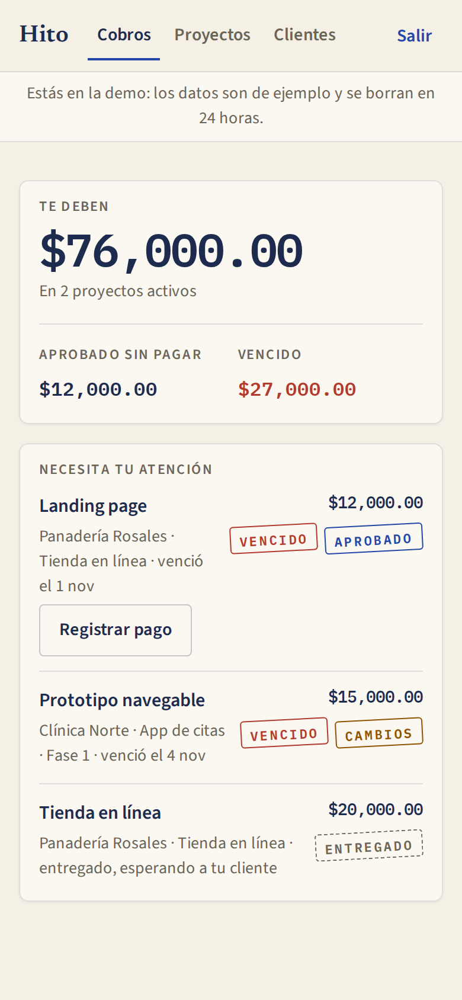
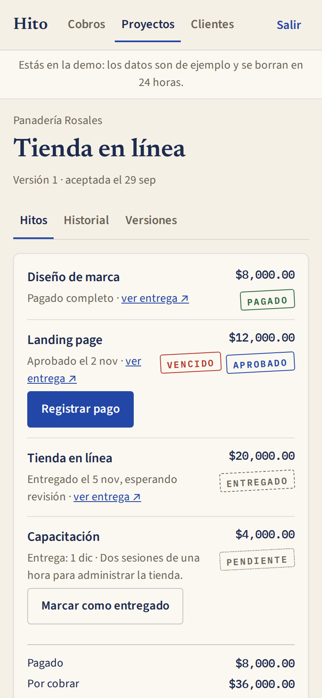
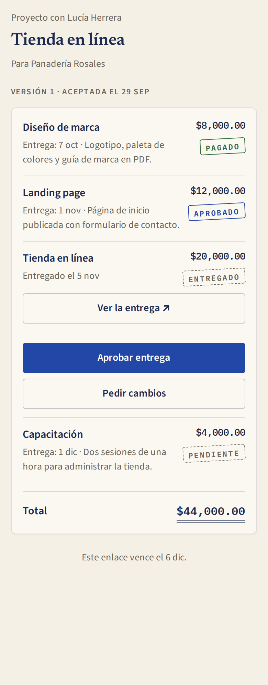
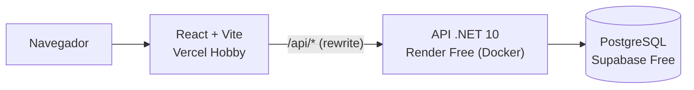
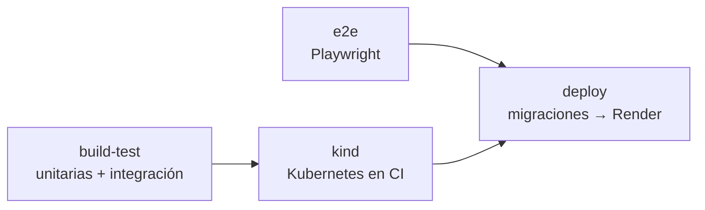

# Hito

**Cada entrega aprobada, cada cobro claro.**

Un freelancer acuerda los hitos de un proyecto con su cliente, registra cada entrega y aprobación, y sabe en todo momento qué le deben.

**Demo:** https://hito-one.vercel.app → **Probar la demo** (un clic, sin registro; la cuenta temporal se borra en 24 horas).
Si la demo lleva un rato sin uso, el servidor gratuito tarda hasta un minuto en despertar; la página lo avisa y reintenta sola.

## El problema

El freelancer manda el alcance por WhatsApp, el cliente dice "sí" y semanas después nadie recuerda qué se acordó, qué se entregó ni cuánto falta por pagar. Hito deja todo eso por escrito:

- El cliente **acepta el alcance** desde un enlace privado, sin crear cuenta. Al aceptar, hitos y montos quedan congelados; un cambio crea una versión nueva que también debe aceptarse.
- Cada hito se **entrega con evidencia** (una URL) y el cliente **aprueba o pide cambios** con un comentario obligatorio.
- El freelancer **registra los pagos** y su panel muestra lo **por cobrar**, lo **aprobado sin pagar** y lo **vencido**.
- Todo queda en un **historial** que no se puede editar ni borrar.

## Capturas

| Panel de cobros | Detalle del proyecto | Vista del cliente (móvil) |
|---|---|---|
|  |  |  |

## Arquitectura



- **Backend:** ASP.NET Core 10 en capas `Domain → Application → Infrastructure → Api`. Las reglas de estado (proyecto, versión, hito, pago) viven en el dominio y se prueban sin base de datos. Una transición inválida responde 409.
- **Datos:** EF Core Code-First con Npgsql. Dinero en `numeric(18,2)` / `decimal`. Cada entidad del freelancer tiene `OwnerId` y un filtro global lo aplica a todas las consultas; los datos de otro usuario responden 404.
- **Autenticación:** ASP.NET Core Identity + JWT. Access token en memoria y refresh token rotado en cookie `httpOnly`, `Secure`, `SameSite=Strict`.
- **Enlace del cliente:** token de 256 bits; en la base solo se guarda su SHA-256. Expira a los 30 días y se puede revocar.
- **Frontend:** React 19, TypeScript, TanStack Query y React Router. Sin SSR: casi todo está detrás de un inicio de sesión.

### CI/CD (GitHub Actions)



- `build-test`: compila con advertencias como errores y corre pruebas unitarias y de integración (PostgreSQL real con Testcontainers).
- `e2e`: Playwright recorre crear proyecto → aceptar → entregar → aprobar → pagar contra la API y PostgreSQL reales.
- `kind`: despliega la imagen del `Dockerfile` y PostgreSQL en un clúster `kind`, aplica las migraciones y prueba `/health/ready` y una llamada a la API.
- `deploy` (solo `main`): aplica en Supabase el **mismo bundle de migraciones** que se probó en kind y llama al deploy hook de Render. La API no migra al arrancar.
- Un flujo programado llama a `/health/ready` dos veces por semana para que Supabase no se pause.

## Decisiones

| ADR | Decisión |
|---|---|
| [0001](docs/decisiones/0001-health-checks-live-y-ready.md) | `/health/live` sin dependencias y `/health/ready` con la base: una base pausada no reinicia la API |
| [0002](docs/decisiones/0002-infraestructura-supabase-render-vercel.md) | Supabase, Render y Vercel en plan gratuito y sin tarjeta |
| [0003](docs/decisiones/0003-autenticacion-jwt-y-refresh-en-cookie.md) | Identity + JWT en memoria y refresh token en cookie |
| [0004](docs/decisiones/0004-endpoints-con-dbcontext-y-404-ajeno.md) | Endpoints con `DbContext` directo (sin repositorios ni servicios de aplicación) y 404 para datos ajenos |
| [0005](docs/decisiones/0005-versiones-y-hitos-estables.md) | Hitos estables y términos por versión: los pagos no se pierden al cambiar el alcance |
| [0006](docs/decisiones/0006-prueba-en-kind-y-un-solo-bundle.md) | Prueba en kind con manifiestos simples y un solo bundle de migraciones |

## Pruebas

| Tipo | Cantidad | Qué cubre |
|---|---|---|
| Unitarias (xUnit) | 51 | Transiciones de estado, cálculo de totales, reglas de pago, panel de cobros |
| Integración (Testcontainers) | 50 | API con PostgreSQL real, incluido el aislamiento entre usuarios y pagos simultáneos |
| E2E (Playwright) | 1 | El flujo crítico completo, con freelancer y cliente en navegadores separados |
| Kubernetes (kind) | 1 | Rollout con sondas live/ready, migraciones y llamada real a la API |

## Cómo correrlo

Requisitos: .NET 10, Node 24 y Docker (o Podman).

```bash
cp .env.example .env                 # cambia POSTGRES_PASSWORD
docker compose up -d --wait          # PostgreSQL 17 local

dotnet user-secrets --project src/Hito.Api set ConnectionStrings:Hito "Host=localhost;Database=hito;Username=hito;Password=<la de .env>"
dotnet user-secrets --project src/Hito.Api set Jwt:Clave "$(openssl rand -hex 32)"
dotnet tool restore
dotnet ef database update -p src/Hito.Infrastructure -s src/Hito.Api
dotnet run --project src/Hito.Api    # http://localhost:5186

cd web && npm ci && npm run dev      # http://localhost:5173 (proxy /api → API)
```

Pruebas: `dotnet test` (necesita Docker para Testcontainers). E2E y kind: ver [docs/proyecto/05-calidad.md](docs/proyecto/05-calidad.md).

## Límites conocidos

- **Es una demo de portafolio, no un producto en producción.** Render Free no es para producción y Supabase Free no tiene respaldos automáticos.
- **Arranque en frío:** Render se apaga tras 15 minutos sin tráfico; la primera visita puede tardar hasta un minuto.
- **Pausa de Supabase:** se pausa tras una semana con poca actividad. El flujo programado reduce el riesgo, no lo elimina. Para restaurar: en el panel de Supabase, *Restore project*; las tablas y migraciones se conservan, y cada clic en "Probar la demo" vuelve a crear sus datos de ejemplo.
- **Kubernetes** solo se prueba en `kind` dentro de CI; el despliegue real no usa Kubernetes.
- Los límites de peticiones de `/publico`, `/demo` y el registro son globales, no por IP.
- Fuera de alcance: cobros con tarjeta, facturación o CFDI, envío de correos, tiempo real, equipos y app móvil.
